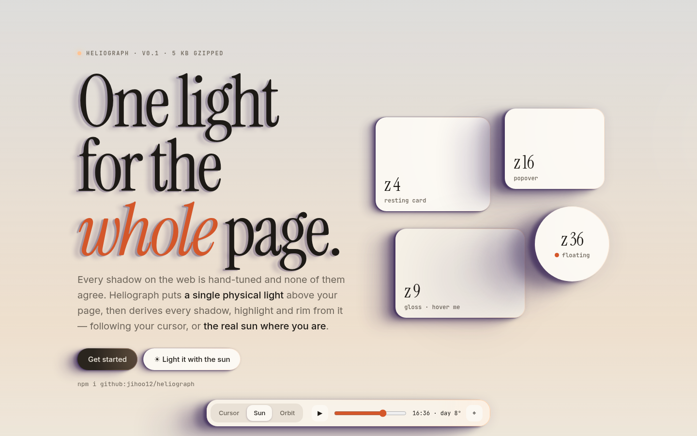
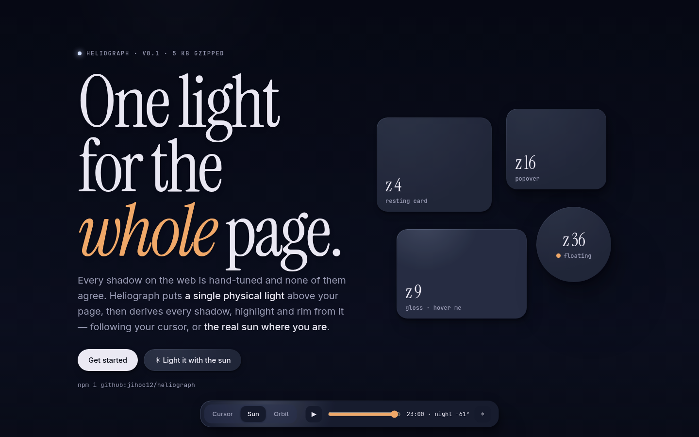
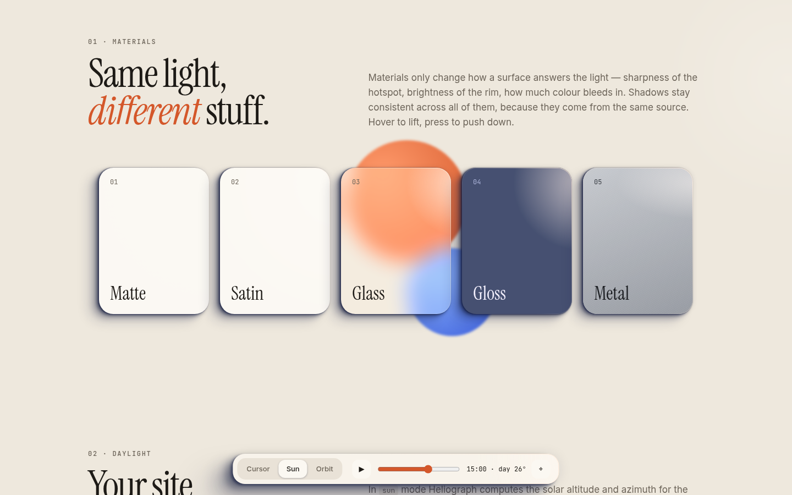

# Heliograph

**One light for the whole page.** · [Live demo](https://jihoo12.github.io/heliograph/)

Every shadow on the web is hand-tuned, and none of them agree. Heliograph puts a single physical light above your page and derives every shadow, specular highlight and rim light from it. The light can follow the cursor, orbit slowly, or be **the real sun at the visitor's location and time of day**: long amber shadows in the morning, short crisp ones at noon, violet dusk and a cool moon after dark.

- ~5 kB gzipped, zero dependencies
- Two attributes to get started; everything else is plain CSS variables
- Real projection (similar triangles), not guessed offsets
- Black-body colour temperature for the light; shadows tinted by the sky instead of grey
- Sleeps when nothing moves, skips off-screen elements, and batches layout reads
- Respects `prefers-reduced-motion` and is SSR-safe

> 🇰🇷 **한 줄 소개** — 페이지 전체에 *하나의 물리적인 광원*을 두고 모든 그림자·하이라이트·림 라이트를 그 광원에서 계산하는 라이브러리입니다. 광원은 마우스를 따라가거나, 방문자 위치의 **실제 태양**이 될 수 있어요. 아침엔 길고 따뜻한 그림자, 정오엔 짧은 그림자, 해질녘엔 보랏빛, 밤엔 달빛으로 바뀝니다.

| Golden hour | Night |
|---|---|
|  |  |



## Install

```sh
npm i @jihoo12/heliograph
```

```js
import { createScene } from '@jihoo12/heliograph';
import '@jihoo12/heliograph/css'; // with a bundler that handles CSS
```

No build step? Use a CDN:

```html
<link rel="stylesheet" href="https://cdn.jsdelivr.net/npm/@jihoo12/heliograph@0.1.0/dist/heliograph.min.css">
<script type="module">
  import { createScene } from 'https://cdn.jsdelivr.net/npm/@jihoo12/heliograph@0.1.0/+esm';
  createScene();
</script>
```

There is also an IIFE build (`dist/heliograph.iife.js`) that exposes `window.Heliograph`.

## Quick start

```html
<link rel="stylesheet" href="heliograph.css">

<div data-hg="surface" data-hg-z="8" data-hg-z-hover="20" data-hg-material="glass">
  A card lit like it's real.
</div>
<h1 data-hg="text">Shadowed type</h1>
<div data-hg="lamp"></div> <!-- optional glow that sits at the light -->

<script type="module">
  import { createScene } from '@jihoo12/heliograph';
  const scene = createScene({ mode: 'pointer' });
</script>
```

```js
scene.set({ mode: 'sun' });                   // the real sun, right now
scene.set({ mode: 'sun', sun: { speed: 1440 } }); // a day per minute
scene.setTime(18.5);                          // jump to 18:30 today
scene.on('frame', (light) => drawCanvas(light)); // drive canvas/WebGL from the same light
```

## How it works

Think of the page as a table seen from above. Each surface hovers `z` px over it, and a light sits at height `h`. The shadow offset for an element centred at `C`, with the light at screen position `L`, is

```
offset = (C − L) · z / (h − z)
```

For the sun, `h → ∞`, so the offset becomes `z · cot(altitude)` along the azimuth. The screen is rotated so that the noon sun is at the top, in both hemispheres. Blur grows with `z` to imitate the penumbra of an area light. Each shadow is built from four layers plus sky occlusion.

The JS only writes CSS variables. `heliograph.css` turns them into visuals, and you can use them directly:

| Per element | |
|---|---|
| `--hg-shadow` | layered `box-shadow` |
| `--hg-text-shadow` | for `data-hg="text"` |
| `--hg-lx`, `--hg-ly` | specular hotspot position, local % |
| `--hg-angle` | direction to the light (CSS gradient degrees) |
| `--hg-spec`, `--hg-facing`, `--hg-z` | strengths and current height |

| On `<html>` | |
|---|---|
| `--hg-light` | light colour as an `r g b` triple, for `rgb(var(--hg-light) / .5)` |
| `--hg-intensity` | 0–1 |
| `--hg-sky-top`, `--hg-sky-bottom` | current sky gradient |
| `--hg-shadow-rgb` | sky-tinted shadow colour |
| `--hg-night` | 0 by day, 1 at night; drive your dark theme with it |
| `--hg-light-x`, `--hg-light-y` | light position on screen, px |

The demo's whole day/night palette is a single `color-mix(..., calc(var(--hg-night) * 100%))`.

## API

### Attributes

| Attribute | Meaning |
|---|---|
| `data-hg="surface"` | Casts a shadow and gets a specular hotspot and rim. Uses `::before`/`::after`. |
| `data-hg="text"` | Casts a `text-shadow`. Combine them: `data-hg="surface text"`. |
| `data-hg="lamp"` / `"sky"` | A glow at the light's position, and a sky-gradient background. CSS only. |
| `data-hg-z`, `data-hg-z-hover`, `data-hg-z-active` | Height in px at rest, on hover and when pressed. Changes are animated. |
| `data-hg-material` | `matte`, `satin` (default), `gloss`, `glass`, `metal` |

### `createScene(options)`

| Option | Default | |
|---|---|---|
| `mode` | `'pointer'` | `'pointer'`, `'sun'`, `'orbit'` or `'fixed'` |
| `light` | `{ x: .5, y: .15, height: 700, color: 5600, intensity: 1 }` | rest position (viewport fraction), height in px, colour as Kelvin / `[r,g,b]` / `'#hex'` |
| `sun` | `{ date: null, lat: null, lon: null, speed: 0 }` | `null` means now / a location guessed from the time zone (no permission prompt) |
| `shadow` | `{ strength: 1, softness: 1, color: null }` | `null` colour means tinted by the sky |
| `sky` | `35` | solar altitude used for the tint in non-sun modes (negative values give a night palette) |
| `idle` | `'auto'` | what pointer mode does with no pointer: `'orbit'` on touch devices, `'stay'` elsewhere |
| `smoothing` | `7` | higher means a snappier light |
| `observe` | `true` | pick up DOM added later |

Returns `{ set, setTime, add, remove, refresh, on, destroy, light, time }`.

## Development

Uses Nix for the toolchain (Node, esbuild, gh):

```sh
nix develop          # or: direnv allow
npm test             # node --test, pure math
npm run build        # dist/ + docs/lib
npm run dev          # build and serve docs/ at :8080
```

## License

MIT
